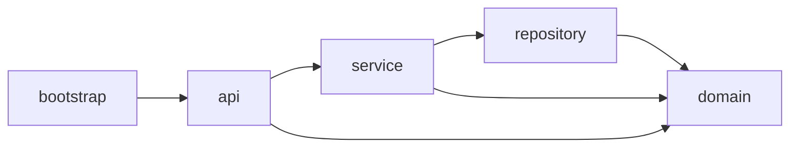
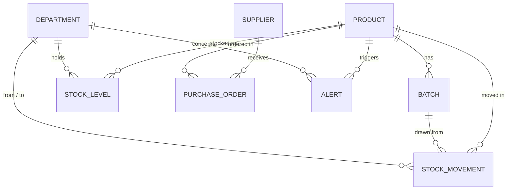
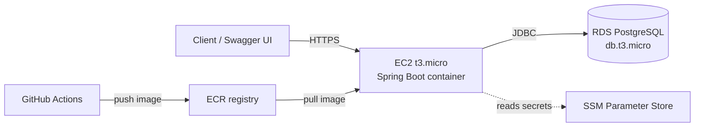

# MediStock — Hospital Supply Inventory Platform

[](https://github.com/<your-username>/medistock/actions/workflows/ci.yml)


MediStock is a REST API for managing medical supplies across hospital departments.
It tracks products, batches and stock levels, enforces expiry rules, picks stock
First-Expired-First-Out, and automatically raises alerts and draft purchase orders
when supplies run low.

The project is built as a multi-module Maven application with Spring Boot, JPA,
PostgreSQL and Spring Security, containerised with Docker and deployed to AWS.
It was developed in collaboration with [Claude Code](https://www.anthropic.com/claude-code)
as an exercise in working effectively with an AI coding agent — see
[Working with Claude Code](#working-with-claude-code).

---

## Table of contents

- [Why this domain](#why-this-domain)
- [Features](#features)
- [Architecture](#architecture)
- [Tech stack](#tech-stack)
- [Getting started](#getting-started)
- [API overview](#api-overview)
- [Business rules](#business-rules)
- [Testing](#testing)
- [Deployment](#deployment)
- [Live demo access](#live-demo-access)
- [Design decisions](#design-decisions)
- [Working with Claude Code](#working-with-claude-code)
- [Roadmap](#roadmap)

---

## Why this domain

Hospital inventory is a domain where a plain CRUD application is not enough.
Medication expires, some products must stay refrigerated, stock moves between
departments, and running out of a critical item is not an option. These
constraints produce real business logic — transactional transfers, FEFO batch
selection, scheduled expiry scans — which is what this project sets out to
demonstrate.

---

## Features

- **Product & batch management** — products with categories, minimum stock levels
  and cold-storage flags; batches with batch numbers and expiry dates
- **Department stock tracking** — per-department stock levels for every product
- **Stock movements** — intake, transfer, usage, disposal and return, each recorded
  in an auditable movement log
- **FEFO picking** — movements always consume the earliest-expiring batch first
- **Expiry enforcement** — expired batches are blocked from use; batches expiring
  within 30 days trigger warnings
- **Low-stock automation** — falling below the minimum threshold raises an alert
  and generates a draft purchase order
- **Purchase order lifecycle** — `DRAFT → SUBMITTED → CONFIRMED → DELIVERED`
  (or `CANCELLED`)
- **Role-based security** — JWT authentication with `ADMIN` and read-only `VIEWER` roles
- **Interactive API docs** — Swagger UI generated from the OpenAPI spec

---

## Architecture

### Module structure

```
medistock/
├── medistock-domain/        # JPA entities, enums, shared constants
├── medistock-repository/    # Spring Data JPA repositories
├── medistock-service/       # Business logic, validation, scheduled jobs
├── medistock-api/           # REST controllers, DTOs, exception handling, security
├── medistock-bootstrap/     # Application entry point, configuration, seed data
├── docker-compose.yml
└── pom.xml                  # Parent POM
```

Dependencies flow in one direction only:



### Domain model



### Deployment architecture



---

## Tech stack

| Layer | Technology |
|---|---|
| Language | Java 21 |
| Framework | Spring Boot 3.x |
| Persistence | Spring Data JPA, Hibernate |
| Database | PostgreSQL 16 |
| Migrations | Flyway |
| Security | Spring Security, JWT (jjwt) |
| API docs | SpringDoc OpenAPI / Swagger UI |
| Testing | JUnit 5, Mockito, Testcontainers |
| Build | Maven (multi-module) |
| Containers | Docker, Docker Compose |
| CI/CD | GitHub Actions |
| Cloud | AWS EC2, RDS, ECR, SSM Parameter Store |

---

## Getting started

### Prerequisites

- Java 21
- Docker and Docker Compose
- Maven 3.9+ (or use the included `./mvnw` wrapper)

### Run with Docker Compose (recommended)

```bash
git clone https://github.com/<your-username>/medistock.git
cd medistock
cp .env.example .env          # adjust values if needed
docker compose up --build
```

The API starts on `http://localhost:8080`, with a PostgreSQL container alongside it.
Flyway applies the schema and the seed data loader fills the database with a
realistic set of departments, products, batches and suppliers.

### Run from the IDE

Start only the database, then run the application:

```bash
docker compose up -d postgres
./mvnw -pl medistock-bootstrap -am spring-boot:run
```

### Default local accounts

| Username | Password | Role |
|---|---|---|
| `admin` | `admin123` | ADMIN |
| `viewer` | `viewer123` | VIEWER |

> These accounts exist only in the local seed data. The deployed instance uses
> separate credentials — see [Live demo access](#live-demo-access).

### Explore the API

Open Swagger UI at `http://localhost:8080/swagger-ui.html`, call
`POST /api/v1/auth/login`, and paste the returned token into the **Authorize** dialog.

```bash
# Obtain a token
curl -X POST http://localhost:8080/api/v1/auth/login \
  -H "Content-Type: application/json" \
  -d '{"username":"admin","password":"admin123"}'

# List products below their minimum stock level
curl http://localhost:8080/api/v1/products/low-stock \
  -H "Authorization: Bearer <token>"
```

---

## API overview

All endpoints are versioned under `/api/v1`. Full request/response schemas are
available in Swagger UI.

| Resource | Endpoints |
|---|---|
| Auth | `POST /auth/login` |
| Products | `GET, POST /products` · `GET, PUT, DELETE /products/{id}` · `GET /products/{id}/stock` · `GET /products/low-stock` |
| Batches | `GET, POST /batches` · `GET /batches/{id}` · `GET /batches/expiring?days=30` |
| Departments | `GET, POST /departments` · `GET /departments/{id}` · `GET /departments/{id}/stock` |
| Stock movements | `GET, POST /movements` · filter by `productId`, `departmentId`, `from`, `to` |
| Purchase orders | `GET, POST /orders` · `GET /orders/{id}` · `PATCH /orders/{id}/status` |
| Alerts | `GET /alerts?resolved=false` · `PATCH /alerts/{id}/resolve` |

### Error format

All errors share one response shape, produced by a global `@ControllerAdvice`:

```json
{
  "timestamp": "2026-10-19T09:15:00Z",
  "status": 409,
  "error": "Conflict",
  "message": "Batch B-2024-117 expired on 2026-10-01 and cannot be used",
  "path": "/api/v1/movements"
}
```

---

## Business rules

| Rule | Behaviour |
|---|---|
| **FEFO picking** | Usage and transfer movements consume the batch with the earliest expiry date first, splitting across batches if needed |
| **Expiry block** | Movements referencing an expired batch are rejected with `409 Conflict` |
| **Expiry warning** | A daily scheduled job creates an `EXPIRY_WARNING` alert for batches expiring within 30 days |
| **Low stock** | When a department's stock drops below `minimumStockLevel`, a `LOW_STOCK` alert and a draft purchase order are created |
| **Atomic transfers** | Transfers decrement the source and increment the destination inside one `@Transactional` method — no partial updates |
| **Cold storage** | Products flagged `requiresColdStorage` can only be moved to departments with cold-storage capability |
| **Order lifecycle** | Purchase orders can only advance along valid status transitions; delivered orders create an intake movement |

---

## Testing

```bash
./mvnw verify
```

- **Unit tests** cover the service layer with Mockito — FEFO selection, threshold
  checks, order state transitions and validation rules
- **Integration tests** run every endpoint against a real PostgreSQL instance via
  Testcontainers, so migrations and queries are tested exactly as in production
- **CI** runs the full suite on every push and pull request via GitHub Actions

Docker must be running for the integration tests.

---

## Deployment

The application runs on AWS:

1. GitHub Actions builds the project, runs the tests and builds a Docker image
2. The image is pushed to Amazon ECR
3. The EC2 instance pulls and runs the latest image
4. The application connects to PostgreSQL on Amazon RDS
5. Database credentials and the JWT secret are read from SSM Parameter Store —
   no secrets live in the repository

Configuration is controlled through Spring profiles (`local`, `test`, `prod`)
and environment variables. See `.env.example` for the full list.

---

## Live demo access

A deployed instance is available for recruiters and hiring teams.
Access uses a read-only `VIEWER` account, so the data can be explored but not changed.

**To request access, contact me at <your-email> or via [LinkedIn](<your-linkedin-url>).**
I'll send a personal login, usually within one working day.

> The demo instance may be paused outside active application periods. If it is
> offline, let me know and I'll start it up.

---

## Design decisions

**Multi-module Maven structure.** Separating domain, persistence, service and API
layers into modules enforces the dependency direction at build time — a controller
cannot reach into a repository by accident. It mirrors how larger enterprise
codebases are organised.

**Flyway over Hibernate auto-DDL.** The schema is versioned in SQL migrations,
so every environment — local, test containers, RDS — is built from the same
reviewed scripts. `ddl-auto` is set to `validate`.

**FEFO in the service layer.** Batch selection lives in a dedicated service
rather than in a database query, which keeps the rule readable and unit-testable
and makes it easy to extend (e.g. reserving batches for specific departments).

**Testcontainers instead of H2 for integration tests.** PostgreSQL-specific
behaviour (types, constraints, query semantics) is tested against PostgreSQL itself,
avoiding the false confidence of an in-memory substitute.

**Application-level access control.** Recruiter access is handled with Spring
Security roles rather than AWS network rules. It costs nothing, needs no extra
infrastructure, and lets access be granted or revoked per person.

---

## Working with Claude Code

MediStock was built in collaboration with Claude Code, Anthropic's agentic coding
tool. The goal was not to have the agent write the project unsupervised, but to
practise the workflow modern teams are adopting:

- **I owned the design** — domain model, module boundaries, business rules and the
  staged MVP plan were specified up front and refined iteratively
- **The agent handled scaffolding and volume** — multi-module POM setup, Flyway
  migrations, seed data, DTO mapping and large parts of the test suite
- **Every change was reviewed** — generated code was read, tested and corrected
  before being committed; the commit history reflects that process

A short write-up of what worked well and where the agent needed guidance is in
[`docs/claude-code-notes.md`](docs/claude-code-notes.md).

---

## Roadmap

- [x] **Stage 1 — Core API:** entities, repositories, services, CRUD endpoints,
      FEFO movements, Flyway, seed data, Swagger UI, Docker Compose
- [ ] **Stage 2 — Quality layer:** JWT security, validation, global error handling,
      scheduled alert jobs, auto purchase orders, unit and integration tests, CI
- [ ] **Stage 3 — AWS deployment:** ECR, EC2, RDS, Parameter Store, HTTPS

Possible extensions: a small React dashboard for stock and alerts, CSV import for
batch intake, and a Kotlin-based notification service consuming alert events.

---

## Author

**Moritz** — Java developer based in Germany
[GitHub](https://github.com/<your-username>) · [LinkedIn](<your-linkedin-url>) · <your-email>
